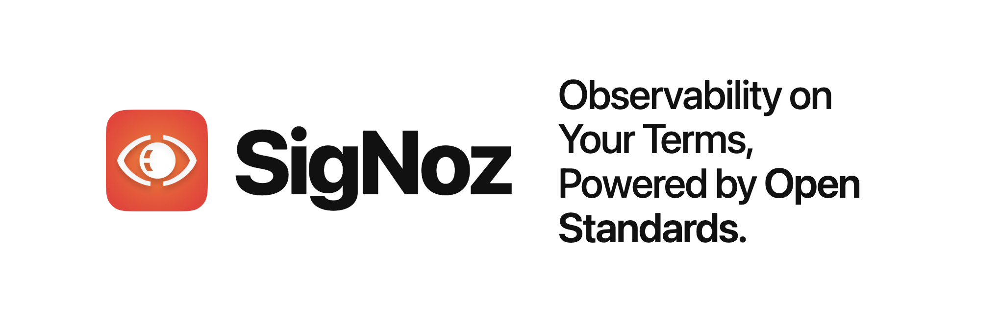

<p align="center">
  <a href="https://signoz.io" target="_blank">
    <picture>
      <source media="(prefers-color-scheme: dark)" srcset="docs/readme-assets/signoz-hero-dark.png" width="900">
      <source media="(prefers-color-scheme: light)" srcset="docs/readme-assets/signoz-hero-light.png" width="900">
      
    </picture>
  </a>
</p>

<h1 align="center" style="border-bottom: none">SigNoz Helm Charts</h1>

<p align="center">
  <a href="https://github.com/SigNoz/charts/actions/workflows/release.yaml"></a>
  <a href="LICENSE"></a>
  <a href="https://github.com/SigNoz/charts/stargazers"></a>
  <a href="https://github.com/SigNoz/charts/issues"></a>
  <a href="https://signoz.io/slack"></a>
</p>

<p align="center"><b>Run SigNoz on Kubernetes with Helm.</b></p>

<p align="center">The Helm charts for SigNoz, its Kubernetes collection agent, the SigNoz MCP server and the SigNoz Operator.</p>

<h3 align="center">
  <a href="https://signoz.io/docs/install/kubernetes/"><b>Documentation</b></a> &bull;
  <a href="https://signoz.io/teams/"><b>SigNoz Cloud</b></a> &bull;
  <a href="https://signoz.io/slack"><b>Slack</b></a> &bull;
  <a href="https://signoz.io"><b>Website</b></a>
</h3>

## Overview

This repository holds the Helm charts that SigNoz publishes to the Helm repository at `https://charts.signoz.io`.

Each chart lives in its own directory under [`charts/`](charts) and is released by itself.

## About SigNoz

[SigNoz](https://signoz.io) is an open-source observability platform built on OpenTelemetry, with logs, metrics, traces, alerts, and dashboards in one place. These charts are how you run it on Kubernetes.

- Get started with [SigNoz Cloud](https://signoz.io/teams/) for free, or [self-host SigNoz](https://signoz.io/docs/install/self-host/).
- Star and explore the main project at [SigNoz/signoz](https://github.com/SigNoz/signoz).

## Charts

| Chart | Name | Version | Installation |
|---|---|---|---|
| SigNoz | [`signoz`](charts/signoz) |  | [Get started](charts/signoz/README.md#installing-the-chart) |
| Kubernetes Collection Agent | [`k8s-infra`](charts/k8s-infra) |  | [Get started](charts/k8s-infra/README.md#installing-the-chart) |
| SigNoz MCP Server | [`signoz-mcp-server`](charts/signoz-mcp-server) |  | [Get started](charts/signoz-mcp-server/README.md#installing-the-chart) |
| SigNoz Operator | [`signoz-operator`](charts/signoz-operator) |  | [Get started](charts/signoz-operator/README.md#installing-the-chart) |

## Getting Started

Prerequisites: a Kubernetes cluster and [Helm](https://helm.sh/docs/intro/install/).

Add the SigNoz Helm repository:

```bash
helm repo add signoz https://charts.signoz.io
helm repo update signoz
```

Install SigNoz:

```bash
helm upgrade --install my-release signoz/signoz --namespace signoz --create-namespace
```

On success the SigNoz Pods start in the `signoz` namespace. For the other charts, follow the installation instructions linked in the [Charts](#charts) table.

For a Kustomize-based install, try [Foundry](https://github.com/SigNoz/foundry) and follow the [Kustomize guide](https://signoz.io/docs/setup/kubernetes/kustomize/).

## Upgrading

Read the [upgrade guides](https://signoz.io/docs/operate/migration/) before you move to a new chart version.

## Development

```bash
helm unittest charts/<chart> --file 'tests/**/*_test.yaml'    # unit tests
ct lint --config ct.yaml --charts charts/<chart>              # lint
make chart-docs CHARTS=charts/<chart>                          # regenerate the chart README
```

## Contributing

We ❤️ contributions big or small. Read the [contributing guide](CONTRIBUTING.md), then open an [issue](https://github.com/SigNoz/charts/issues) or a pull request to get started. Not sure where to begin? Just ping us on `#contributing` in our [Slack community](https://signoz.io/slack).

## Community

Come say Hi to us on [Slack](https://signoz.io/slack) 👋 to talk observability, OpenTelemetry, and SigNoz, and to connect with other users and contributors. If you have ideas, questions, or feedback, share them on [GitHub Discussions](https://github.com/SigNoz/signoz/discussions).

## License

Licensed under the [MIT License](LICENSE).
